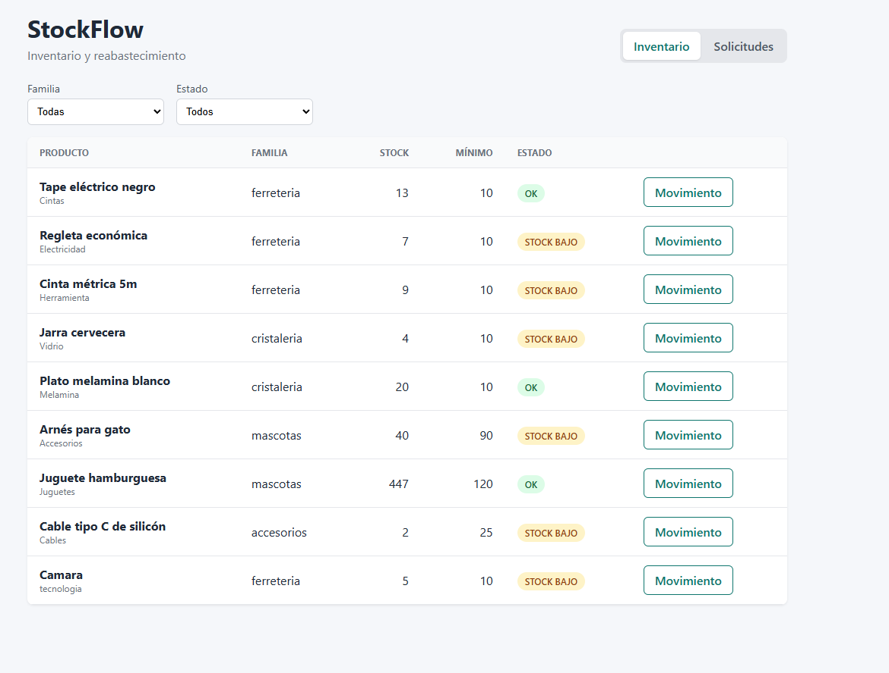
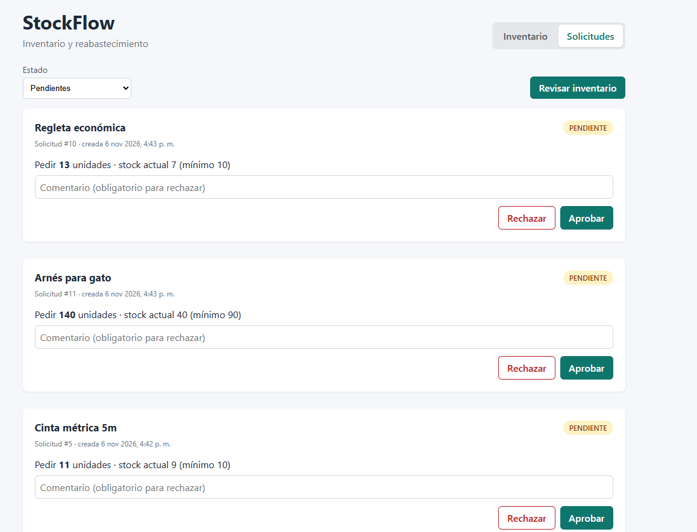

# StockFlow


Full-stack inventory app with automated restock requests and a **human-in-the-loop approval workflow**: the system detects low stock and proposes what to order, and a supervisor approves or rejects each request.

Built to replace a manual Excel-based inventory process at a distribution company: 214 products across 7 product families, with stock status typed by hand and no history of changes.

| Inventory | Approval inbox |
|---|---|
|  |  |

## Features

- **Products** organized by family, with stock status (`OK`, `STOCK BAJO`, `AGOTADO`) **calculated**, not typed by hand. Filter by family and status.
- **Stock movements** (IN/OUT) as an audit trail. Stock is never edited directly, and an OUT larger than the current stock is rejected with `409 Conflict`.
- **Automatic restock requests** when stock falls below the minimum (quantity = 2 × minimum − current stock), without duplicates.
- **Approval workflow:** `PENDIENTE → APROBADA / RECHAZADA`. Rejections require a comment; resolving a request twice returns `409`.
- **Batch job** that scans the whole inventory and creates the missing requests (idempotent).
- **Concurrency-safe:** row-level locking (`SELECT ... FOR UPDATE`) prevents race conditions on simultaneous stock-outs.
- **React frontend:** inventory table with filters, stock movement form and a supervisor approval inbox.

## Tech Stack

| Layer | Technology |
|---|---|
| Frontend | React 19, TypeScript, Vite, ESLint |
| API | Python 3.14, FastAPI, Pydantic |
| Database | PostgreSQL 17, SQLAlchemy 2 (ORM), psycopg 3 |
| Infrastructure | Docker, Docker Compose, Nginx |
| Testing & CI | pytest, FastAPI TestClient, GitHub Actions |

## Architecture

```
Browser
  │  downloads the app            │  fetch + JSON (CORS: frontend origin only)
  ▼                               ▼
frontend (Nginx :5173)        api (FastAPI :8000) ──── SQLAlchemy ────► db (PostgreSQL :5432)
React + TypeScript              main.py      → endpoints (HTTP only)       volume: pgdata
                                schemas.py   → input/output validation
                                services.py  → business rules
                                models.py    → tables (ORM)
└──────────────────────── Docker Compose network ────────────────────────┘
```

- Business errors (`NoEncontradoError`, `ConflictoError`) are raised by the service layer and mapped to HTTP `404` / `409` in one place with exception handlers.
- Configuration comes from environment variables (`POSTGRES_HOST`, `VITE_API_URL`), so the same code runs locally and in Docker.

## Getting Started

### Option A: everything in Docker

**Requirements:** Docker Desktop and Git.

```bash
git clone https://github.com/sebas2507/stockflow.git
cd stockflow
cp .env.example .env            # Windows: copy .env.example .env  (then set your own password)
docker compose up --build -d
```

- App: **http://localhost:5173**
- API docs (Swagger): **http://localhost:8000/docs**

The API creates the tables and sample data on startup (the seed is idempotent).

### Option B: development mode (hot reload)

**Requirements:** Python 3.12+, Node 20.19+, Docker.

```bash
# Terminal 1: database + API
docker compose up -d db
python -m venv .venv
.venv\Scripts\activate           # macOS/Linux: source .venv/bin/activate
pip install -r requirements.txt
python -m app.seed
fastapi dev app/main.py

# Terminal 2: frontend
cd frontend
npm install
npm run dev
```

## API Endpoints

| Method | Endpoint | Description |
|---|---|---|
| GET | `/health` | Health check |
| GET | `/products?familia=&estado=` | List products, with optional filters |
| GET | `/products/{id}` | Get one product |
| POST | `/products` | Create a product |
| POST | `/products/{id}/movements` | Register a stock IN/OUT (may create a restock request) |
| GET | `/products/{id}/movements` | Movement history |
| GET | `/restock-requests?estado=` | List restock requests |
| POST | `/restock-requests/generate` | Scan inventory and create missing requests |
| POST | `/restock-requests/{id}/approve` | Approve a pending request |
| POST | `/restock-requests/{id}/reject` | Reject a pending request (comment required) |

## Tests and CI

```bash
docker exec -it stockflow-db psql -U stockflow -d stockflow -c "CREATE DATABASE stockflow_test;"   # first time only
pytest -v
```

- **19 tests:** unit tests for the business rules (including boundary values) and integration tests that call the API against an isolated PostgreSQL test database, recreated for each test.
- The batch restock endpoint was built with **TDD** (tests first, then the code).
- **GitHub Actions** runs on every push, in two parallel jobs: `pytest` against a PostgreSQL service container, and `npm ci` + ESLint + a type-checked production build for the frontend.

## Design Decisions

- **Derived data isn't stored:** stock status is calculated from stock and minimum, so it can never get out of sync.
- **Movements + current stock** are updated in the same transaction: fast reads with a full audit trail.
- **Approving a request doesn't change stock:** stock increases when the goods actually arrive (an IN movement), matching the real process.
- **Validation in layers:** the frontend gives instant feedback, Pydantic validates every request, and database constraints (`CHECK`, foreign keys) protect the data even if the API is bypassed.
- **Rejected requests** can be recreated by the batch job if the product is still below the minimum. A cooldown period is a possible improvement.

## Roadmap

- [x] REST API with business rules and approval workflow
- [x] Automated tests and CI with GitHub Actions
- [x] React + TypeScript frontend
- [x] Full stack in Docker Compose
- [ ] Authentication and roles (operator / supervisor)
- [ ] Database migrations with Alembic
- [ ] Import script that cleans the original Excel and flags incomplete rows for review
- [ ] Scheduled daily inventory review
